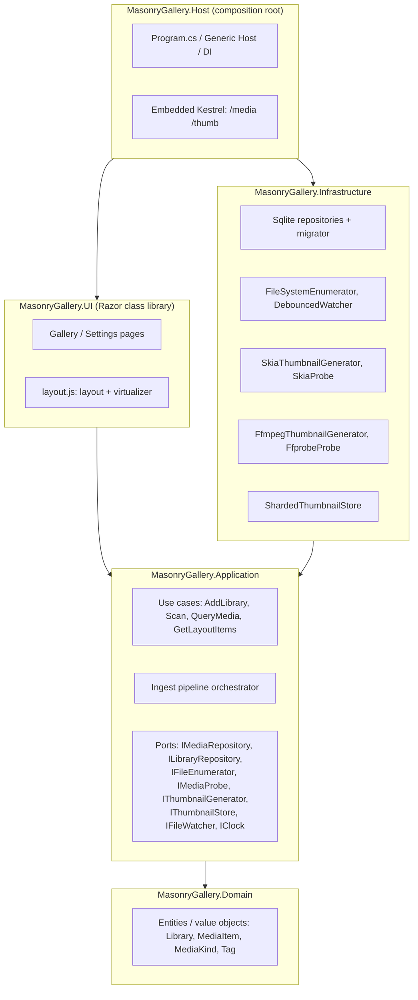

# MasonryGallery: Design Specification v2

Revision of `plan.md`. Section 1 lists the problems in the original. The rest is the corrected, deployable specification.

---

## 1. Review of the original plan

### 1.1 Blocking issues (would fail or hurt in practice)

| # | Issue | Fix |
|---|-------|-----|
| 1 | **MAUI has no Linux support.** The plan lists "Photino / MAUI". | Use **Photino.Blazor** (WebView2 on Windows, WebKitGTK on Linux, WKWebView on macOS). Drop MAUI. |
| 2 | **§4.5 "serve files directly from local paths into `src`"** does not work. WebViews block `file://` from a non-file origin. Exposing arbitrary paths is also a security hole. | Run an **embedded Kestrel endpoint on loopback** (`127.0.0.1`, random port, per-session token). Serve by **media ID**, never by path, with HTTP Range support for video. See §7. |
| 3 | **DOM virtualization with unknown item sizes.** A masonry layout needs every item's height *before* it is rendered. | Extract **width/height at ingest** and store them in the DB. Compute layout from metadata, not from the DOM. See §8. |
| 4 | **Cheap placeholders "immediately"** is undefined. | Define a 3-stage pipeline: enumerate, then metadata, then thumbnail. See §5. |
| 5 | **`Tags` indexed as a column.** | Use a normalized `Tag` / `MediaTag` table. A plain column can't be indexed for set queries. |
| 6 | **Absolute paths stored per file.** | Store `LibraryId` + **relative path**. Moving or remounting a library is then a single-row update. |
| 7 | **No handling of offline libraries**, such as an unplugged USB drive or unmounted NAS. A naive rescan would delete everything. | Add a `Library.Status` field. Never delete records for an offline library. Offline libraries are not scanned and are shown as unavailable. |
| 8 | **FileSystemWatcher is unreliable.** Linux inotify has watch limits (`max_user_watches`), buffers overflow, and network shares are unsupported. | Use the watcher as a hint only. **Debounce** events, and always run a periodic **reconcile scan** as the source of truth. See §5.4. |
| 9 | "SQLite / LiteDB" is left open. | Choose **SQLite** (WAL, FTS5). Drop LiteDB. |
| 10 | Dependencies: "install .NET SDK", "add FFmpeg to PATH". | End users get a **self-contained build**, so no SDK is required. **Bundle FFmpeg and ffprobe** next to the app. PATH is only a fallback. |

### 1.2 Gaps to fill

- There are no measurable performance targets (§2).
- Change detection is not specified (§5.2).
- The thumbnail cache has no eviction, versioning or invalidation (§6).
- Video playback, seeking and codec compatibility are not covered (§7).
- There is no error handling, logging, configuration, security, packaging, test or CI strategy (§9–§13).
- The layers are muddled. `ThumbnailJobQueue` sits in Core but needs infrastructure. The folder names carry numeric prefixes. `FolderScanner` has no interface.
- "SSD strictly required" is unrealistic. Libraries on HDD or NAS must work, just with lower concurrency (§5.5).

---

## 2. Goals and non-functional targets

**Functional**
- The user manages multiple **Libraries** (root directories). Each is scanned recursively for images and videos.
- The app shows a masonry gallery with a lightbox and video player, and filters by library, type, date, tag and filename.
- The library stays current through live watching and reconciliation.
- It runs on Linux (primary) and Windows (secondary).

**Performance budgets** (reference machine: 4 cores, SSD, 100k media files)

| Metric | Target |
|--------|--------|
| App start to first gallery paint (warm DB) | < 1 s |
| Initial enumeration of 100k files (warm cache) | < 10 s; items appear in the UI progressively |
| Incremental rescan with no changes | < 5 s, no thumbnail work |
| Scroll | 60 fps; DOM nodes < ~300 at any time |
| Thumbnail throughput | ≥ 150 images/s on 4 cores (video is slower) |
| Steady-state RAM (UI + core) | < 500 MB, independent of library size |
| Query page (200 items) | < 20 ms |

These are enforced by benchmarks and a synthetic 100k-file dataset generator (§12).

---

## 3. Technology decisions

| Concern | Decision | Rationale |
|---------|----------|-----------|
| Runtime | **.NET 10 LTS** (`net10.0`, pinned in `global.json`). Self-contained publish; trimming is optional (see §11). | LTS support window, and the user needs no SDK. Gives access to C# 14, `FrozenSet`, `System.Threading.Channels` and `System.IO.Hashing` improvements. |
| Shell | **Photino.Blazor** | Cross-platform, lightweight, and uses the system WebView. |
| UI | Blazor with a thin **JS module** for layout and scroll | Blazor interop per frame is too slow. Scroll handling stays in JS. |
| DB | **Microsoft.Data.Sqlite + Dapper** (or hand-written ADO) | EF Core adds overhead on bulk upserts. Migrations are handled by a simple numbered-SQL migrator. |
| Image decode | **SkiaSharp** (`SKCodec` with scaled decode) | Reads headers for dimensions. DCT-scaled JPEG decode is much faster than a full decode. |
| Video | **FFmpeg / ffprobe** as bundled child processes | Process isolation: a crash or hang can't take down the app. |
| Hashing | **System.IO.Hashing** (XxHash3) | Fast non-cryptographic hash. |
| Logging | `Microsoft.Extensions.Logging` + **Serilog** (rolling file) | |
| DI/Config | `Microsoft.Extensions.Hosting` (Generic Host), Options pattern | Gives lifetime management, background services and testability. |
| Tests | xUnit, FluentAssertions, BenchmarkDotNet, Playwright (UI smoke) | |

**Linux runtime dependency:** `libwebkit2gtk-4.1` (Photino tracks this). Document the package names per distro. Under Wayland, set `GDK_BACKEND` if rendering problems occur.

**Supported formats (v1)**
- Images: jpg, jpeg, png, webp, gif, bmp, avif (if the Skia build supports it).
- Videos: mp4, mkv, webm, mov, avi, m4v.
- HEIC and RAW: out of scope for v1. The `IMediaDecoder` abstraction leaves room for them later.
- Formats the WebView can't play natively (some mkv/avi/hevc) are flagged in the DB. The first-version fallback is "open in the external player". Transcoding is a later phase.

---

## 4. Solution architecture (Clean / Hexagonal)

Dependencies point inward: `Host` → `UI`, `Infrastructure` → `Application` → `Domain`. Domain and Application never reference Blazor, SQLite, Skia or FFmpeg.



### 4.1 Solution layout

```text
MasonryGallery/
├── MasonryGallery.sln
├── global.json                     # pin .NET 10 SDK
├── Directory.Build.props           # TargetFramework net10.0, Nullable, TreatWarningsAsErrors, analyzers
├── Directory.Packages.props        # central package management
├── .editorconfig
├── src/
│   ├── MasonryGallery.Domain/            # entities, value objects, no dependencies
│   ├── MasonryGallery.Application/       # use cases, ports, pipeline, channels
│   ├── MasonryGallery.Infrastructure/
│   │   ├── Persistence/ (Migrations/*.sql, Repositories, SqliteConnectionFactory)
│   │   ├── FileSystem/ (FileEnumerator, DebouncedWatcher, VolumeInfo)
│   │   ├── Imaging/ (SkiaProbe, SkiaThumbnailGenerator)
│   │   ├── Video/ (FfprobeProbe, FfmpegThumbnailGenerator, FfmpegLocator)
│   │   └── Thumbnails/ (ShardedThumbnailStore, CacheJanitor)
│   ├── MasonryGallery.UI/                # Razor class library (+ wwwroot/js/layout.js)
│   └── MasonryGallery.Host/              # Photino, Kestrel endpoints, DI, config
├── tests/
│   ├── MasonryGallery.Domain.Tests/
│   ├── MasonryGallery.Application.Tests/ # fakes for ports
│   ├── MasonryGallery.Infrastructure.Tests/  # real SQLite (temp file), temp directories
│   ├── MasonryGallery.UI.Tests/          # bUnit + layout.js unit tests (vitest)
│   └── MasonryGallery.Benchmarks/
├── tools/  (GenerateDataset, packaging scripts)
└── docs/   (ADRs, this spec)
```

Changes from the original: no numeric prefixes, explicit `Application` and `Domain` layers, and ports in the center. The thumbnail queue is a hosted service in Application, backed by infrastructure ports.

### 4.2 Patterns used

- **Ports and adapters** for everything touching IO, so Application is testable with fakes.
- **Producer–consumer pipeline** with bounded `Channel<T>`s (§5).
- **Repository pattern**, but with set-based methods such as `UpsertBatch` and `QueryPage`. Per-entity CRUD is too slow.
- **Result type** (`Result<T>`) for expected failures. Exceptions are for bugs.
- **Options pattern** with validation (`ValidateOnStart`).
- **Event aggregator or `IObservable` progress stream** from the pipeline to the UI. It is throttled to about 10 updates/s.
- **Strategy** per media kind (`IMediaProbe` / `IThumbnailGenerator` selected by `MediaKind`).
- **CancellationToken everywhere**, with a root token tied to application shutdown.

---

## 5. Ingest pipeline

```
Library added / app start / watcher hint / manual rescan
   └─► [Stage 1: Enumerate] ─ch1─► [Stage 2: Diff + Upsert] ─ch2─► [Stage 3: Probe] ─ch3─► [Stage 4: Thumbnail]
```

All channels are **bounded** (for example 1024 items, `FullMode = Wait`) so a huge library can't blow up memory.

### 5.1 Stage 1: Enumeration (fast path)
- Use `FileSystemEnumerable<T>` / `EnumerationOptions { RecurseSubdirectories = true, IgnoreInaccessible = true, AttributesToSkip = Hidden|System }`. This avoids a per-file `FileInfo` allocation and a stat call per file.
- Filter by extension in the enumerator's `ShouldIncludePredicate`, using a `FrozenSet<string>` with an ordinal-ignore-case comparer.
- Yield `(relativePath, size, mtimeUtc)`. Parallelize across **top-level subdirectories** only, to avoid thrashing the disk.
- Don't follow symlinks or reparse points by default (loop protection). Make it a per-library option.
- Skip directories that contain a `.nomedia` file. Provide a global ignore-pattern list (`@eaDir`, `.thumbnails`, `node_modules`…).

### 5.2 Stage 2: Diff and upsert (change detection)
- Identity is `(LibraryId, RelPath)`. A change is `size` or `mtime` differing from the stored values. Content hashing is **not** done at scan time.
- Batch into groups of 1–5k rows and run **one transaction per batch** with a prepared `INSERT … ON CONFLICT DO UPDATE`.
- Mark-and-sweep for deletions: stamp each seen row with `ScanId`. At the end of a *completed, successful* scan, rows of that library with an older `ScanId` are soft-deleted (`DeletedAt`). If the scan was cancelled or errored, **skip the sweep**. Hard-delete after a retention period.
- New items appear in the gallery as soon as their row is committed. They show a placeholder at a default aspect ratio until probed (§8).
- Move and rename detection (optional, phase 2): match a quick-hash (size + first and last 64 KB via XxHash3) between deleted and added rows to preserve tags and favorites.

### 5.3 Stage 3: Probe
- Images: `SKCodec.Create` reads the header only → width, height, EXIF orientation (swap dimensions for orientations 5–8), and `DateTaken` from EXIF, falling back to mtime.
- Video: one `ffprobe -print_format json -show_streams -show_format` per file → width, height, rotation, duration, codec. Limit video-probe concurrency to 2–4.
- Persist the metadata in batches. Mark `ProbeState = Done | Failed`. On failure, store `ErrorCode` and don't retry until the file changes.

### 5.4 Watching and reconciliation
- One `FileSystemWatcher` per library root (`IncludeSubdirectories`). Events go into a **debounce buffer** (500 ms–2 s quiet window, coalesced by path), then trigger a targeted rescan of the affected paths.
- Handle `Error` (buffer overflow) by scheduling a full reconcile of that library.
- On Linux, detect inotify exhaustion and fall back to **polling reconcile** (every N minutes) with a visible warning.
- Network paths: the watcher is disabled and polling is used.
- Always reconcile on startup, and every 15 min while the app is idle.
- Files still being written: skip a file if `size` or `mtime` changed within the last ~2 s, and retry later.

### 5.5 Stage 4: Thumbnail generation
- Priority: items **near the current viewport** go first (the UI reports visible ID ranges), then newest first, then the rest. Implement it as two channels (high and normal priority) read with preference, or an in-memory priority queue in front of the channel.
- Worker count: `Environment.ProcessorCount - 1` for SSD. Detect rotational or network storage (`/sys/block/*/queue/rotational` on Linux; `DeviceIoControl` seek-penalty on Windows) and use 1–2 workers.
- FFmpeg workers are capped separately (about half the cores).
- **Job state is persisted** (`ThumbState` on the media row). On restart, unfinished items are resumed. Nothing is lost if the app is killed.
- Retry policy: 2 retries with backoff. After that, mark `Failed` and show a "broken" tile. Per-job timeout (video: 30 s). Kill the ffmpeg process on cancellation.
- Pause and throttle: pause on battery or when the window is hidden (optional), with a user-visible "pause indexing" button.

---

## 6. Thumbnails

- Sizes (long edge): **small 320 px** for the grid and **medium 960 px** for the lightbox preview. The original is served in full-screen view. Generate the medium size lazily on first open.
- Format: **WebP** (quality ~80) via Skia, or JPEG if WebP encode is unavailable.
- JPEG fast path: `SKCodec` with `GetScaledDimensions` to decode at 1/2, 1/4 or 1/8 scale. This is several times faster than a full decode. Also consider an EXIF-embedded thumbnail if it is large enough.
- Video thumbnail: `ffmpeg -ss <10% of duration> -i file -frames:v 1 -vf scale=320:-2`. Seeking before `-i` is fast. Fall back to 0 s on failure.
- Store: `{cacheRoot}/{version}/{size}/{id % 256:x2}/{id}.webp`. Sharding avoids huge directories. `{version}` bumps when the generator settings change.
- Cache key invalidation: the DB stores `ThumbVersion` + the source `mtime`. A change in either regenerates the thumbnail.
- Write to a temp file and then rename atomically.
- `CacheJanitor`: removes orphaned thumbnails and enforces an optional size cap (LRU by access time).
- Cache location: `$XDG_CACHE_HOME/MasonryGallery` on Linux, `%LOCALAPPDATA%\MasonryGallery\cache` on Windows. It is configurable and safe to delete.
- Placeholder: use a **dominant color** (or a 16×16 blurhash/thumbhash, ~25 bytes) stored in the DB so the tile is never blank. Compute it from the scaled-down decode that is already available.

---

## 7. Media serving (replaces §4.5 of the original)

An embedded **ASP.NET Core Kestrel** server, bound to `127.0.0.1:<random port>` only.

| Route | Behavior |
|-------|----------|
| `GET /thumb/{id}/{size}` | Returns the cached WebP file via `Results.File`. Sends `Cache-Control: immutable` plus an `ETag`. If the thumbnail is not ready, returns **202/404** and the UI shows the placeholder and retries on the progress event. |
| `GET /media/{id}` | Streams the original with `enableRangeProcessing: true` (required for video seeking). |
| `GET /api/*` (optional) | Query endpoints, or use direct C# calls through the Blazor Hybrid component model. |

Security rules:
- Requests contain **IDs only**. The server resolves `ID → library root + relative path` from the DB, then verifies the canonical path is still **inside the library root** (guards against `..` and symlink escape).
- Every request must carry a **random per-launch token** (query string or header, with `Origin` checks). Otherwise any web page the user visits could read local files through `localhost`.
- Bind only to loopback. Don't enable CORS. Don't serve directory listings.
- Content-Type is determined from the extension. Send `X-Content-Type-Options: nosniff`.
- The server streams from disk with `FileStream` using `FileOptions.Asynchronous | SequentialScan`. **No byte[] buffering of whole files**, which preserves the original goal of avoiding GC pressure.

Video playback: use the HTML `<video>` element. WebKitGTK codec support depends on the system's GStreamer plugins (`gst-plugins-good/bad/libav`), so document it. Files whose codec the engine can't play are flagged and offered "open externally".

---

## 8. UI and virtualized masonry layout

**Core idea:** the layout is a pure function of `(items' aspect ratios, container width, column width, gap)` and does not depend on the DOM.

1. The backend serves **lightweight layout records**: `id, w, h, kind, thumbReady, placeholder` (≈ 24 bytes/item). Fetch them in chunks via keyset pagination, or all at once up to roughly 1M items, which is under 30 MB.
2. `layout.js` computes `(x, y, width, height)` per item using the "shortest column" algorithm. This is O(n log c) with a min-heap, and it is **incremental**: appending items only extends the column state.
3. Total scroll height is set on a spacer. Only the items that intersect `[scrollTop - buffer, scrollTop + viewport + buffer]` are rendered as `position:absolute` / `transform: translate3d` nodes. A binary search over per-column sorted y positions finds the visible window. Recycle DOM nodes.
4. Images use `loading="lazy"` plus `decoding="async"`, and ``. The tile's background is the placeholder color or blur, so it is never blank. The layout never shifts because sizes are known beforehand.
5. On resize, debounce with `ResizeObserver` and relayout. **Scroll anchoring**: keep the first visible item at the same position.
6. When the progress stream says "thumbnail ready for id X", swap the `src` or class for that tile only (cross-fade). No re-render of the grid.
7. Items whose probe isn't finished have an unknown aspect ratio. Use 1:1, and apply a **batched relayout** (at most every ~500 ms) when real sizes arrive. Prefer waiting for the probe on the first screen's worth of items.
8. Interop is only used at coarse boundaries: `scroll → visible range` (throttled with `requestAnimationFrame`), `visible range → C# for the priority hint`, and `C# → JS` for appended chunks. No per-item interop.

Other UI pieces:
- **Lightbox**: keyboard navigation (←/→/Esc), preloads neighbors, shows EXIF, and offers zoom and pan.
- **Filters**: library, type, date range, tag, filename search (FTS5), and sorting (date taken or added, name).
- **Settings**: library list (add, remove, rescan, enable/disable), thumbnail size and cache size, the worker-count setting, and ignore patterns.
- **Status bar**: scanning/indexing progress ("12,340 / 48,000 thumbnails"), warnings (offline library, watch limit).
- Accessibility: keyboard focus, `alt` text from the filename, `prefers-reduced-motion`.
- **Folder picker**: Photino provides a native dialog. On Linux, fall back to a typed path if the portal is unavailable.

---

## 9. Data model

SQLite with PRAGMAs set on every connection: `journal_mode=WAL`, `synchronous=NORMAL`, `foreign_keys=ON`, `temp_store=MEMORY`, `mmap_size=256MB`, `busy_timeout=5000`. Use **one writer connection** (serialized through a single writer service) and a pool of readers.

```sql
CREATE TABLE Library (
  Id INTEGER PRIMARY KEY,
  Name TEXT NOT NULL,
  RootPath TEXT NOT NULL UNIQUE,
  Enabled INTEGER NOT NULL DEFAULT 1,
  Status INTEGER NOT NULL DEFAULT 0,       -- 0 Online, 1 Offline, 2 Scanning, 3 Error
  FollowSymlinks INTEGER NOT NULL DEFAULT 0,
  LastScanId INTEGER NOT NULL DEFAULT 0,
  LastScanUtc INTEGER
);

CREATE TABLE Media (
  Id INTEGER PRIMARY KEY,                  -- rowid; used in URLs
  LibraryId INTEGER NOT NULL REFERENCES Library(Id) ON DELETE CASCADE,
  RelPath TEXT NOT NULL,
  FileName TEXT NOT NULL,
  Kind INTEGER NOT NULL,                   -- 0 Image, 1 Video
  SizeBytes INTEGER NOT NULL,
  ModifiedUtc INTEGER NOT NULL,            -- unix ms
  DateTaken INTEGER,                       -- falls back to ModifiedUtc
  DateAdded INTEGER NOT NULL,
  Width INTEGER, Height INTEGER,
  DurationMs INTEGER,
  Placeholder BLOB,                        -- <= ~32 bytes (thumbhash). Not image data.
  ProbeState INTEGER NOT NULL DEFAULT 0,   -- 0 Pending, 1 Done, 2 Failed
  ThumbState INTEGER NOT NULL DEFAULT 0,
  ThumbVersion INTEGER NOT NULL DEFAULT 0,
  ErrorCode INTEGER,
  QuickHash INTEGER,                       -- lazy, for move detection / duplicates
  ScanId INTEGER NOT NULL,
  DeletedAt INTEGER,
  Favorite INTEGER NOT NULL DEFAULT 0,
  UNIQUE (LibraryId, RelPath)
);

CREATE INDEX IX_Media_Sort_Taken ON Media (DateTaken DESC, Id DESC) WHERE DeletedAt IS NULL;
CREATE INDEX IX_Media_Library_Taken ON Media (LibraryId, DateTaken DESC, Id DESC) WHERE DeletedAt IS NULL;
CREATE INDEX IX_Media_Kind_Taken ON Media (Kind, DateTaken DESC, Id DESC) WHERE DeletedAt IS NULL;
CREATE INDEX IX_Media_Pending ON Media (ThumbState) WHERE ThumbState = 0;
CREATE INDEX IX_Media_Quick ON Media (QuickHash) WHERE QuickHash IS NOT NULL;

CREATE TABLE Tag (Id INTEGER PRIMARY KEY, Name TEXT NOT NULL UNIQUE COLLATE NOCASE);
CREATE TABLE MediaTag (
  MediaId INTEGER NOT NULL REFERENCES Media(Id) ON DELETE CASCADE,
  TagId   INTEGER NOT NULL REFERENCES Tag(Id)   ON DELETE CASCADE,
  PRIMARY KEY (MediaId, TagId)
) WITHOUT ROWID;
CREATE INDEX IX_MediaTag_Tag ON MediaTag (TagId, MediaId);

CREATE VIRTUAL TABLE MediaFts USING fts5(FileName, RelPath, content='Media', content_rowid='Id', tokenize='unicode61 remove_diacritics 2');

CREATE TABLE SchemaVersion (Version INTEGER NOT NULL);
```

Rules:
- **Keyset pagination** (`WHERE (DateTaken, Id) < (@lastDate, @lastId) ORDER BY DateTaken DESC, Id DESC LIMIT 200`). Never `OFFSET`.
- No image bytes in the DB. The placeholder is a tiny hash, not an image.
- Forward-only numbered migrations (`Migrations/0001_init.sql`…), applied transactionally on startup. Back up the DB file before a migration.
- Paths: use a case-sensitive comparison on Linux and case-insensitive on Windows. Normalize separators to `/` in `RelPath`.
- The DB is **a cache of the file system**, so it can be rebuilt. User data (tags, favorites) is the only thing of real value, so back it up and tie it to a path or hash.
- DB location: `$XDG_DATA_HOME/MasonryGallery/gallery.db` on Linux, `%APPDATA%\MasonryGallery` on Windows.

---

## 10. Cross-cutting concerns

- **Error handling:** expected failures (corrupt file, permission denied, ffmpeg missing) return a `Result` and are logged at Warning. They surface in the UI as a count with a details list. Unhandled exceptions go to a global handler that logs them without crashing the shell.
- **Logging:** structured logs with a rolling file (7 days). Each pipeline stage logs timing and counts. A "Open logs folder" menu item.
- **Configuration:** `appsettings.json` provides defaults. User settings are stored in `settings.json` in the app-data dir, with validated options (worker count, cache cap, thumb quality).
- **Single instance:** a lock file or named mutex, to prevent two processes from writing the same SQLite DB.
- **Resource governance:** use `ArrayPool`, `ArrayBufferWriter`, `SKBitmap` disposal and `using`. Decode in worker threads with a cap on concurrent decodes sized by memory budget (large images can use hundreds of MB).
- **Privacy:** fully offline. No telemetry by default. The local server is loopback-only with a token.
- **Path edge cases:** non-UTF-8 Linux file names, very long Windows paths (`\\?\`), Unicode normalization (NFC vs NFD), `#` and `?` in names (URLs use IDs, so this is safe).
- **FFmpeg licensing:** bundle an LGPL build, or let the user point at their own binary. Include the notices.

---

## 11. Packaging and deployment

- `dotnet publish -c Release -r linux-x64|win-x64 --self-contained -p:PublishTrimmed=…`. Trimming may break Blazor reflection or Skia, so test it before enabling it, and consider ReadyToRun instead.
- Linux: **AppImage** or `.deb`, with a documented `libwebkit2gtk-4.1` dependency. A `.desktop` entry. Flatpak is optional, and its sandbox needs filesystem permissions for libraries.
- Windows: MSIX or an installer. The WebView2 evergreen bootstrapper is included.
- FFmpeg: ship `ffmpeg` and `ffprobe` under `tools/ffmpeg/{rid}/`. `FfmpegLocator` checks the bundled copy, then the configured path, then PATH. Startup shows a clear error if none is found. Images still work without it.
- Auto-update is out of scope for v1.

---

## 12. Testing and quality

- **Unit (Domain/Application):** pipeline stages with fake ports. Include cancellation, back-pressure, the failure and retry policy, and "no sweep after an incomplete scan".
- **Integration (Infrastructure):** real SQLite in a temp file (upsert, keyset paging, migrations, FTS). A real temp directory tree for the enumerator and watcher (rename, delete, burst writes, a locked file). Sample fixtures for corrupt images and videos.
- **UI:** unit tests for `layout.js` (a pure function, with property tests that no tiles overlap and columns stay balanced). bUnit for components. A Playwright smoke test against a seeded DB.
- **Performance:** BenchmarkDotNet for enumeration, upsert and thumbnails, plus a `tools/GenerateDataset` tool that creates 100k stub files. CI fails if a budget in §2 regresses by more than 20%.
- **CI:** GitHub Actions, building and testing on ubuntu and windows, with analyzers as errors and a format check.
- Architecture tests (NetArchTest) enforce that Domain and Application never reference Infrastructure or UI.

---

## 13. Roadmap

| Phase | Scope | Exit criteria |
|-------|-------|---------------|
| 0 | Repo scaffolding, `Directory.Build.props`, CI, Photino window with Blazor "hello" on Linux and Windows | WebKitGTK and WebView2 both run |
| 1 | Domain, SQLite schema and migrator, Library CRUD, enumerator and upsert | 100k files indexed within the budget |
| 2 | Probe (Skia, ffprobe), layout.js masonry with virtualization, Kestrel `/thumb` and `/media` | Smooth scroll on 100k items, correct aspect ratios |
| 3 | Thumbnail pipeline, priority, retries, persistence, placeholders, janitor | Throughput target met, restart resumes |
| 4 | Watcher and reconcile, offline libraries, progress UI | Add or remove files while running and the UI updates |
| 5 | Lightbox, video player, filters, FTS search, tags and favorites | Feature complete |
| 6 | Packaging, docs, hardening (security review, fuzz corrupt media) | Release candidate |
| Later | HEIC/RAW, transcoding, duplicates, move detection, auto-update, macOS | n/a |

---

## 14. Risks and open decisions

| Risk or question | Mitigation or default |
|------------------|-----------------------|
| WebKitGTK video codec gaps and rendering quirks (Wayland, NVIDIA) | Document GStreamer packages. Keep a **fallback shell option**: the same Blazor UI served on loopback and opened in the system browser, which is cheap thanks to the Kestrel server. |
| Photino.Blazor is a small project | Hide it behind `IShell` so Avalonia or a browser host can replace it. |
| Trimming and AOT break reflection | Start untrimmed and add trimming later. |
| inotify limits on huge libraries | Polling fallback and a visible warning (§5.4). |
| Very large libraries (> 1M files) | Keyset paging, incremental layout and a bounded memory design are already in place. Validate in benchmarks. |
| Network shares | Watcher off, reduced concurrency, longer timeouts. |
| Decision for you: should tags and favorites live only in the DB, or also in sidecar files or XMP? | Default: DB only (v1). |
| Decision for you: is macOS a target? | Default: no. The design doesn't prevent it. |
| Decision for you: is a headless or web-server mode wanted? | Default: no. The Kestrel layer would make it easy later. |
