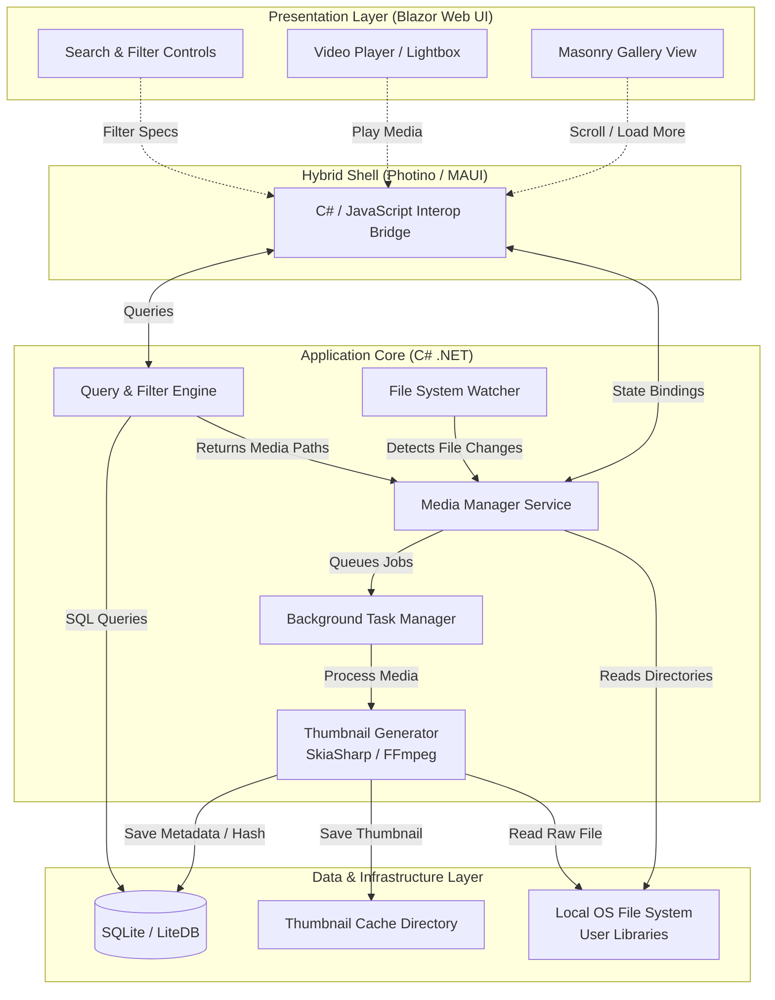

# Standard Operating Procedure: C# Hybrid Media Gallery Architecture

## 1.0 System Requirements

### 1.1 Hardware Specifications

The following hardware minimums are mandated to ensure system stability during parallel file processing operations:

* **Processor:** A multi-core CPU is required. Concurrent execution of media processing threads must be supported by the hardware.
* **Memory:** A minimum of 8 GB RAM is required. Adequate memory overhead is demanded by local caching operations and virtualized Document Object Model (DOM) rendering.
* **Storage:** Solid State Drive (SSD) storage is strictly required. High-speed input/output (I/O) operations are demanded by the SQLite database and thumbnail cache access.

### 1.2 Software Dependencies

The target environments must be provisioned with the following dependencies prior to deployment:

* **Application Framework:** Install the .NET SDK (version 8.0 or newer).
* **Media Processing:** Download and extract FFmpeg binaries. The executable path must be appended to the operating system environment variables.
* **Web Rendering Engine:** Provision WebView2 for Windows environments. Provision WebKitGTK for Linux environments.
* **Graphics Library:** Install SkiaSharp dependencies. Native assets for the target operating system must be included in the project references.

## 2.0 System Architecture Overview

The system architecture is defined as a C# Hybrid application. The presentation layer is isolated from heavy file processing and hardware-level operations to ensure continuous responsiveness during mass file ingestion.



## 3.0 Directory Structure Specification

The following modular directory structure must be provisioned to separate the user interface, business logic, and infrastructure implementations:

```text
MasonryGallery_Solution/
│
├── MasonryGallery.sln                  
│
├── src/
│   │
│   ├── 1_MasonryGallery.Host/          
│   │   ├── Program.cs                  
│   │   ├── appsettings.json            
│   │   └── MasonryGallery.Host.csproj
│   │
│   ├── 2_MasonryGallery.UI/            
│   │   ├── wwwroot/                    
│   │   │   ├── css/
│   │   │   │   └── masonry-layout.css  
│   │   │   ├── js/
│   │   │   │   └── virtualizer.js      
│   │   │   └── index.html              
│   │   ├── Pages/
│   │   │   ├── GalleryView.razor       
│   │   │   └── Settings.razor          
│   │   ├── Components/
│   │   │   ├── MasonryGrid.razor       
│   │   │   ├── MediaCard.razor         
│   │   │   └── VideoLightbox.razor     
│   │   └── MasonryGallery.UI.csproj
│   │
│   ├── 3_MasonryGallery.Core/          
│   │   ├── Models/
│   │   │   ├── MediaFile.cs            
│   │   │   └── LibraryFolder.cs
│   │   ├── Interfaces/
│   │   │   ├── IMediaRepository.cs     
│   │   │   └── IThumbnailService.cs    
│   │   ├── Services/
│   │   │   └── MediaManager.cs         
│   │   ├── Background/
│   │   │   └── ThumbnailJobQueue.cs    
│   │   └── MasonryGallery.Core.csproj
│   │
│   └── 4_MasonryGallery.Infrastructure/
│       ├── Database/
│       │   └── SqliteMediaContext.cs   
│       ├── FileSystem/
│       │   ├── FolderScanner.cs        
│       │   └── LiveFolderWatcher.cs    
│       ├── Media/
│       │   ├── SkiaThumbnailGen.cs     
│       │   └── FFmpegVideoGen.cs       
│       └── MasonryGallery.Infrastructure.csproj
│
└── tests/
    ├── MasonryGallery.Core.Tests/      
    └── MasonryGallery.Infra.Tests/     

```

## 4.0 Implementation Procedures

### 4.1 Concurrency and Background Processing

1. Implement a Producer-Consumer pattern utilizing `System.Threading.Channels`.
2. Push all file paths into the channel during directory scans.
3. Assign background worker threads to pull from the channel and generate thumbnails. The main UI thread must not be blocked during this process.

### 4.2 UI Virtualization

1. Implement Document Object Model (DOM) virtualization within the frontend.
2. Calculate the viewport coordinates dynamically.
3. Restrict browser engine rendering exclusively to media elements currently visible within the calculated viewport bounds.

### 4.3 Database Optimization

1. Initialize a SQLite database for metadata storage.
2. Index frequently queried columns, including `DateAdded`, `MediaType`, and `Tags`.
3. Store absolute file paths as string values. Binary image data must never be saved within the database records.

### 4.4 Media Processing Degradation

1. Generate low-resolution placeholders immediately upon the addition of a new directory.
2. Render placeholders in the UI while high-resolution thumbnails are processed.
3. Swap the temporary placeholders asynchronously once thumbnail generation is completed by the background worker thread.

### 4.5 Media Serving Protocol

1. Serve static media files directly from local file paths to the HTML `src` attributes.
2. Prohibit the reading of image data into C# byte arrays prior to UI transmission; garbage collection pauses are triggered by memory bloat.